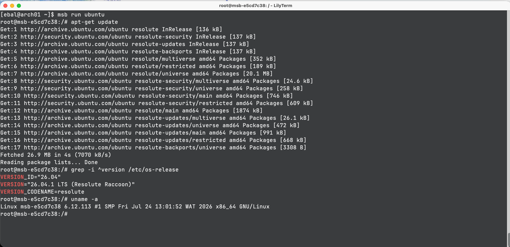
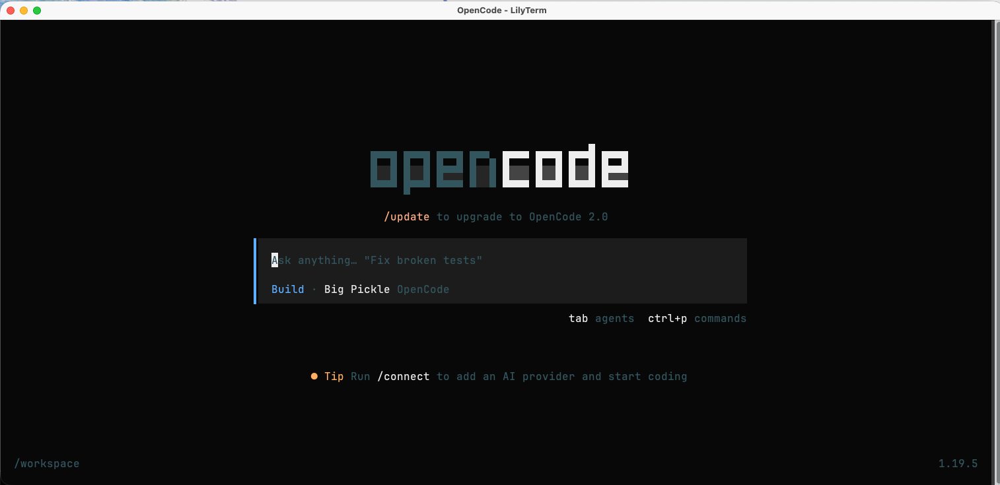
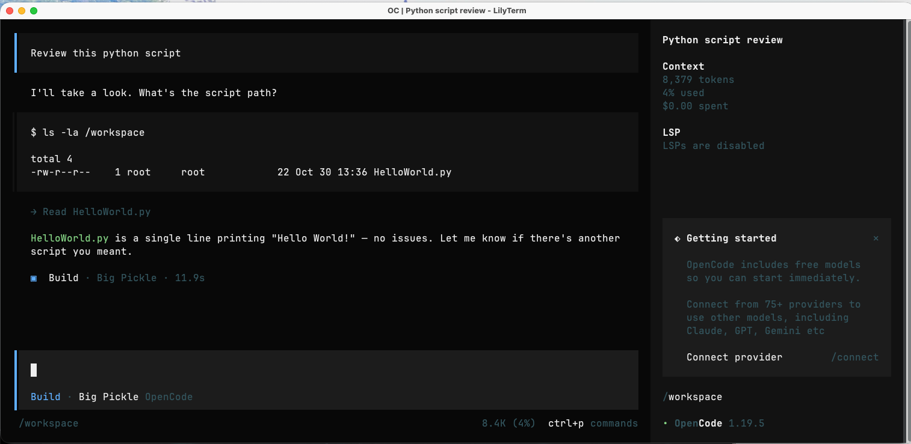

# Running AI Agents inside a microVM sandbox

I wanted to run an AI coding agent harness in an isolated environment. You can find several programs such as Docker containers, Kata Containers, Firecracker, smolvm, krunvm, brig.sh, and Microsandbox. There are pros and cons to all of them. I wanted something I could run locally without much effort and with a simple setup.

For my ArchLinux system with KVM enabled, I chose [Microsandbox](https://github.com/superradcompany/microsandbox), a local runtime for microVM which each sandbox runs as a lightweight virtual machine with its own Linux kernel, filesystem, and network boundary.

## Check KVM support

First thing, is that we much verify we already have a KVM device (virtualization enabled) and our user is indeed on the kvm group!

```bash
ls -l /dev/kvm             # usually: crw-rw---- root kvm
id $USER                   # is "kvm" in the groups?

sudo usermod -aG kvm $USER # only if it's missing
id $USER                   # is "kvm" in the groups?
```

## Install the Linux binary files

I wanted to avoid the `curl &#124; sh` approach, so I downloaded version `v0.7.11` and its `libkrunfw` library into my home directory.

The installation uses one binary and one library from [libkrunfw](https://github.com/libkrun/libkrunfw), 2 files total!

To make it simple to copy/paste to your system:

```bash
mkdir -p ~/.microsandbox/{bin,lib}

V=v0.7.11
B="https://github.com/superradcompany/microsandbox/releases/download/$V"

curl -sfL -o ~/.microsandbox/bin/msb "$B/msb-linux-x86_64"
chmod 755 ~/.microsandbox/bin/msb
curl -sfL -o ~/.microsandbox/lib/libkrunfw.so.5.6.1 "$B/libkrunfw-linux-x86_64.so"

export PATH="$HOME/.microsandbox/bin:$PATH"
```

I ran the self-update command to check the installation. It reported that version `v0.7.11` was current and linked `msb` and `microsandbox` in `~/.local/bin`:

```text
$ msb self update
 • Current version: v0.7.11
 • Latest version: v0.7.11
 ✓ Already up to date.
 ✓ Linked              /home/ebal/.local/bin/msb -> /home/ebal/.microsandbox/bin/msb
 ✓ Linked              /home/ebal/.local/bin/microsandbox -> /home/ebal/.microsandbox/bin/microsandbox
```

## Check the host

I ran `msb doctor` to check the host. It found the required binary and library, CPU virtualization support, and the KVM device. It also reported that APICv was disabled by KVM policy:

```text
$ msb doctor
 • Platform            Linux x86_64
 • Version             v0.7.11
 • MSB_HOME            /home/ebal/.microsandbox
 ✓ msb                 /home/ebal/.microsandbox/bin/msb
 ✓ libkrunfw           /home/ebal/.microsandbox/bin/../lib/libkrunfw.so.5.6.1
 ✓ Root clone          reflink supported
 ✓ CPU virt            vmx
 ✓ KVM device          /dev/kvm
 ✓ KVM access          read/write
warn: KVM APICv: disabled by KVM policy
warn: Intel APICv is disabled by KVM policy
 → APICv is optional; sandbox correctness and isolation are unaffected
 → it is a privileged, host-wide KVM setting; stop all KVM guests first
 → enable for the current boot: sudo modprobe -r kvm_intel && sudo modprobe kvm_intel enable_apicv=1
 → verify: cat /sys/module/kvm_intel/parameters/enable_apicv
 ✓ Host setup is ready.
```

APICv is optional. The doctor output says that disabling it does not affect sandbox correctness or isolation. Changing this setting affects the host and requires stopping all KVM guests first, so I left it unchanged.


## MacOS

You can also install microsandbox to your macbook, and for this I will show the `curl &#124; bash` approach:

```bash
❯ curl -fsSL https://install.microsandbox.dev &#124; sh

  Microsandbox Installer

info Detected platform: darwin-aarch64
info Latest version: v0.7.11
info Downloading microsandbox...
[#---------------------------------------]   3%  1MB/30MB  microsandbox-darwin-aarch64.tar.gz^R
[########################################] 100%  30MB/30MB  microsandbox-darwin-aarch64.tar.gz
[########################################] 100%  0MB/0MB  checksums.sha256
info Verifying checksum...
done Checksum verified
info Extracting...
done Installed msb to /Users/<user>/.microsandbox/bin/msb
done Linked microsandbox -> msb in /Users/<user>/.microsandbox/bin/
done Installed libkrunfw to /Users/<user>/.microsandbox/lib/
done Linked /Users/<user>/.local/bin/msb -> /Users/<user>/.microsandbox/bin/msb
done Linked /Users/<user>/.local/bin/microsandbox -> /Users/<user>/.microsandbox/bin/microsandbox

  Note: /Users/<user>/.local/bin is not on your PATH.
  Add it to your shell profile if you want to run msb directly:

    export PATH="/Users/<user>/.local/bin:$PATH"

done Installation complete! Run '/Users/<user>/.local/bin/msb --help' to get started.

```

## Start Ubuntu

Microsandbox can run OCI images, so it can use docker container images. I started an Ubuntu image with `msb run ubuntu`:

```text
$ msb run ubuntu

root@msb-3cd3976f:/# grep VERSION /etc/os-release
VERSION_ID="26.04"
VERSION="26.04.1 LTS (Resolute Raccoon)"
VERSION_CODENAME=resolute

root@msb-3cd3976f:/# uname -a
Linux msb-3cd3976f 6.12.113 #1 SMP Fri Jul 24 13:01:52 WAT 2026 x86_64 GNU/Linux

root@msb-3cd3976f:/# exit
exit
```

The image was available locally after the run:

```text
$ msb image ls
REFERENCE    DIGEST                 SIZE        CREATED
ubuntu       sha256:157dc3d6e4a3    40.2 MiB    2026-10-30 15:04:28
```




and on your macbook:

```bash
❯ msb run ubuntu

root@msb-7d63a2f7:/# uname -a
Linux msb-7d63a2f7 6.12.113 #1 SMP Fri Jul 24 13:01:52 WAT 2026 aarch64 GNU/Linux

root@msb-7d63a2f7:/# grep -i ^version /etc/os-release
VERSION_ID="26.04"
VERSION="26.04.1 LTS (Resolute Raccoon)"
VERSION_CODENAME=resolute

```

## Running the OpenCode agent harness

Now the interesting part, can I run a micro isolated virtual machine to run my AI coding agent with access only to my program ?

So, I pulled the latest OpenCode image:

```bash
$ msb pull ghcr.io/anomalyco/opencode
 ✓ Pulled              ghcr.io/anomalyco/opencode (13.8s)
```

and I checked that the image was available locally:

```text
$ msb image ls
REFERENCE                     DIGEST                 SIZE        CREATED
ghcr.io/anomalyco/opencode    sha256:c19f5dd52946    86.6 MiB    2026-10-30 15:21:21
```

Then I created a small project directory and a Python file for the agent to work with:

```bash
mkdir -pv ~/project_a/
echo 'print("Hello World!")' > ~/project_a/HelloWorld.py
```

I started the OpenCode image with the project directory mounted at `/workspace`. The sandbox has 2 GB of memory as opencode needs at least 2G of RAM to work:

```bash
msb run -t --name opencode --replace
  --mount-dir ~/project_a/:/workspace:rw
  --workdir /workspace --memory 2G
  ghcr.io/anomalyco/opencode
```

it worked as you can see below





That's it !
Evaggelos

