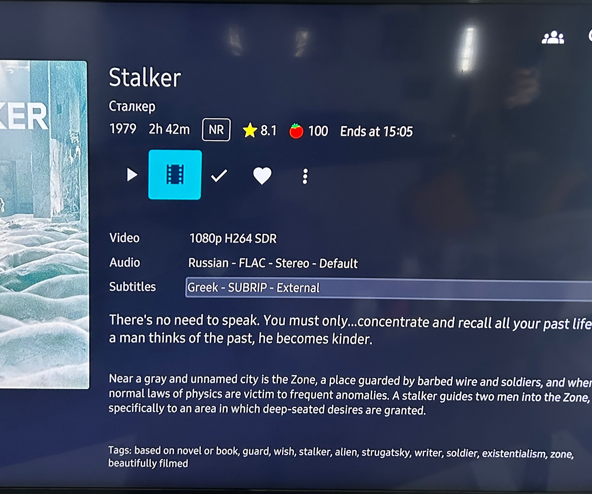

# Jellyfin Trailers for movies and TV shows in my Samsung TV

I wanted the **Trailer** button in **Jellyfin** to actually do something for the movies and shows I have at home. Jellyfin can play a trailer file that sits next to your media usually there are no such files.  In this blog post you can find my personal notes on how I got trailers for my movies and series, automatically, with Jellyfin running inside Docker.

There is also another part, the one that took me more time than it should to figure out, when trailers worked in the web browser, but in my Samsung TV the trailer button tried to start the trailer and then ... nothing happened.

> **JellyTrailers**: Download movie and TV show trailers with yt-dlp and place them next to your media.

## How Jellyfin finds trailers

Jellyfin looks for "local trailer files". The easiest way is a file called `trailer.mp4` inside the movie folder (or inside the series folder for TV shows):

```
/media/Movies/Stalker (1979)/
├── Stalker (1979).mkv
└── trailer.mp4
```

If that file exists, the **Trailer** button in Jellyfin shows up on the item page. No plugin is needed to play it.

The JellyTrailers plugin only creates those files. It searches YouTube and downloads the trailer with **yt-dlp**.

## Step 1 - yt-dlp and ffmpeg inside the container

The official `jellyfin/jellyfin` image does **NOT** include `yt-dlp`. I didn't want to build my own image. So I keep two static binaries on the host and mount them read-only into the container. One for yt-dlp and one for `ffmpeg` for transcoding.

```bash
$ mkdir -p services/jellyfin/local-bin
$ cd services/jellyfin/local-bin

local-bin$ curl -sLo yt-dlp https://github.com/yt-dlp/yt-dlp/releases/latest/download/yt-dlp_linux
local-bin$ curl -sL https://johnvansickle.com/ffmpeg/releases/ffmpeg-release-amd64-static.tar.xz | tar xJ --strip-components=1 --wildcards '*/ffmpeg'

local-bin$ chmod +x yt-dlp ffmpeg
```

verify

```bash
local-bin$ ./yt-dlp --version
2026.08.19

local-bin$ ./ffmpeg -version | head -1
ffmpeg version 7.0.2-static https://johnvansickle.com/ffmpeg/  Copyright (c) 2000-2024 the FFmpeg developers
```

YouTube gives you video and audio as separate streams. yt-dlp needs ffmpeg to join them into one file, that's why we need both.

## Step 2 - docker compose

The important line is the last volume. `/usr/local/bin` is already in the container's `PATH`, so there is no need to change any environment variable.

```yaml
services:
  jellyfin:
    image: jellyfin/jellyfin:latest
    container_name: jellyfin
    restart: unless-stopped
    volumes:
      - ./services/jellyfin/config:/config
      - /jellyfin_cache:/cache
      - ./media:/media
      # yt-dlp + ffmpeg for the JellyTrailers plugin
      - ./services/jellyfin/local-bin:/usr/local/bin:ro
    ports:
      - "8096:8096"
```

It is best to use a specific version instead of the `latest` tag.

```bash
$ docker compose up -d
$ docker exec jellyfin yt-dlp --version
2026.08.19
```

## Step 3 - install the plugin

In Jellyfin, go to **Dashboard** -> **Plugins** -> **Repositories** and add a new repository:

- Name: `JellyTrailers`
- URL: `https://raw.githubusercontent.com/fl4pj4ck/JellyTrailers/main/manifest.json`

Then from the **Catalog** install **JellyTrailers** and restart Jellyfin.

```bash
$ docker restart jellyfin
$ grep 'Loaded plugin: "JellyTrailers"' services/jellyfin/config/log/log_*.log | tail -1
[2026-11-05 21:39:20.268 +02:00] [INF] [9] Emby.Server.Implementations.Plugins.PluginManager: Loaded plugin: "JellyTrailers" "1.6.1.0"
```
It's important to look at the logs, maybe somethins is missing or something is not in the right directory.

also `docker compose logs -f` works.

## Step 4 - configure the plugin

Open the plugin settings. These are mine:

| Setting | Value |
|---|---|
| yt-dlp path | `/usr/local/bin/yt-dlp` |
| Trailer path | `trailer.mp4` |
| Quality | `1080p` |
| Max trailers per run | `50` |
| TMDb/OMDb fallback | enabled |

and the most important one, **yt-dlp options (JSON)**:

```json
{"format": "bestvideo[height<=1080][vcodec^=avc1]+bestaudio[ext=m4a]/best[height<=1080][vcodec^=avc1]/best[height<=1080]/best"}
```

I will explain below this format string , because I got it wrong twice, three times if you count my wife's request to move from 720 to 1080p for the trailers :D

## Step 5 - run it

The plugin adds a scheduled task called **Download Trailers (JellyTrailers)**. Mine runs every day at 02:00.

Run it once by hand from **Dashboard** -> **Scheduled Tasks**. Then scan your libraries, so Jellyfin finds the new files.

> [Be aware: ]{.underline}You just got a new movie from your DVD … the trailer will not show immediatle as the scheduler runs at 02.00 in the morning, but you can run it explicit by hand !

```bash
$ find media -name trailer.mp4 | wc -l
```

Some trailers will fail, eg. when the YouTube video is gone. That's fine, the plugin tries again on the next run.

```
WRN Jellyfin.Plugin.JellyTrailers.YtDlpRunner: yt-dlp failed for "Zootopia (2025) trailer": "ERROR: [youtube] BjkIOU5PhyQ: This video is not available"
```

---

## The wrong way

`The format string` saga !

### Wrong way number one

The plugin's own `1080p` quality setting becomes something like `best[height<=1080]`. Which means "the best single file that already has video AND audio, up to 1080p". YouTube dont always offers those, so yt-dlp answers:

```
ERROR: Requested format is not available
```

### Wrong way number two

So I told yt-dlp to download separate streams and join them:

```json
{"format": "bestvideo[height<=1080]+bestaudio/best[height<=1080]/best"}
```

Trailers started to download. In the web browser everything worked. perfect, I thought.

Then I sat in front of my Samsung TV (Q60 series, with the **Jellyfin for Tizen** app) and clicked the trailer button.
The player tried to start, and then nothing happened. No video, no sound. Had to restart my TV the first time

Jellyfin's log said playback had started:

```
[INF] SessionManager: User "username" started playback of "Trailer" ("Jellyfin for Tizen" "0.1.0 ...")
```

but there was no FFmpeg transcode log for that moment. So Jellyfin sent the file as it is (direct play), and the TV could not play it.

Let's see what yt-dlp actually downloaded:
```
    209 av1 opus
      8 h264 opus
      3 vp9 opus
      2 h264 aac
```

If you know, you know.

On YouTube today "bestvideo" means **AV1** and "bestaudio" means **Opus**. Both are good codecs and browsers play them fine.

My TV does not understand them, at least not inside an mp4 file. Jellyfin did not convert them for the TV either.

### The correct way - finally!

Ask YouTube for **H.264** (`avc1`) video and **AAC** (`m4a`) audio. Almost every TV, phone and browser can play that:

```json
{"format": "bestvideo[height<=1080][vcodec^=avc1]+bestaudio[ext=m4a]/best[height<=1080][vcodec^=avc1]/best[height<=1080]/best"}
```

`avc1` + `mp4a` at 1080p. YouTube still offers H.264 up to 1080p, so for a trailer on the TV we lose nothing. Above 1080p YouTube only has VP9 and AV1, and we are back to the same problem.

## Fixing the trailers I already had

New trailers are fine now, but I already had a few files in AV1/Opus. I did not want to download everything again (some YouTube links are already dead). So I converted them with the ffmpeg that comes inside the Jellyfin container.

My server is an old Intel GPU (no, not really), so I used VAAPI to encode H.264. My GPU (again not really) can't decode AV1, so ffmpeg does that part on the CPU. It is slow, about 30 seconds per trailer, but it works.

> My CPU is an Intel Core i7-2600 (Sandy Bridge, 2011, 4 cores / 8 threads), and it has Intel HD Graphics 2000 built in (PCI ID 8086:0102).

a 15y old CPU !

Back to the TV, I press the trailer button, and this time the trailer plays !
and happy wife too :)




That's it !
-Evaggelos

